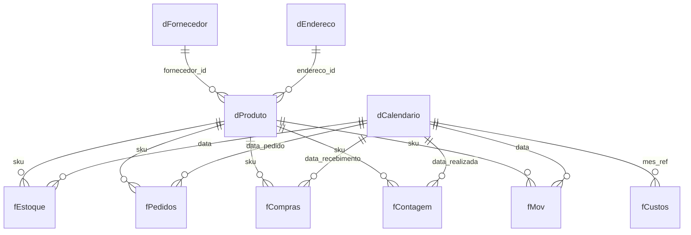

# Projeto 1: Estoque e inventário (40 indicadores)

Base fictícia e modelo de dados para montar um painel de gestão de estoque com **40 indicadores**, organizados em cinco grupos: acuracidade e inventário, giro e cobertura, disponibilidade e nível de serviço, excesso/obsolescência/perdas e custos/retorno.

> Dados 100% fictícios, gerados por simulação. Projeto pessoal de portfólio.

## O que foi simulado

Um centro de distribuição de bens de consumo com **40 SKUs** em 5 categorias, de **01/10/2025 a 30/09/2026** (365 dias):

- demanda com sazonalidade, variação por dia da semana e choques de demanda;
- reposição por ponto de pedido, com estoque de segurança, estoque mínimo e máximo, e compras antecipadas;
- fornecedores com atrasos e entregas parciais;
- avarias, lotes bloqueados e quarentena;
- contagens cíclicas (A a cada 14 dias, B a cada 30, C a cada 60) e um inventário geral, com divergências e recontagens;
- 5 SKUs descontinuados, com estoque obsoleto e descartes.

## Modelo de dados



| Tabela | Conteúdo | Linhas |
|---|---|---|
| fEstoque | Foto diária de cada SKU (saldo, disponível, cobertura, aging, flags de ruptura/excesso/obsoleto) | 14.600 |
| fPedidos | Linhas de pedido (quantidade pedida, atendida, backorder, margem) | ~23 mil |
| fCompras | Pedidos de compra (prazo previsto x real, quantidade) | ~450 |
| fContagem | Contagens de inventário (divergência, recontagem, endereço, status) | ~510 |
| fMov | Movimentações (entrada, saída, ajuste, avaria, descarte) | ~13 mil |
| fCustos | Custos mensais de manter estoque | 12 |
| dProduto, dFornecedor, dEndereco, dCalendario | Dimensões | |

## Como usar no Power BI

1. Importe os CSVs de `dados/` (ou a pasta de trabalho `.xlsx`, que já traz tabelas nomeadas).
2. Marque `dCalendario` como tabela de datas e crie os relacionamentos do diagrama.
3. Cole as medidas de [dax/medidas.md](dax/medidas.md).
4. Compare com [docs/gabarito_mensal.csv](docs/gabarito_mensal.csv). Se bater, o modelo está correto.

## Observações de método

- O indicador 38 (Stock Utilization Rate) admite mais de uma definição; foi adotado o *sell-through*. Está explicado em `dax/medidas.md`.
- Os custos (capital, armazenagem, seguro e mão de obra) usam parâmetros fictícios simples.
- Fill rate e backorder são calculados por linha de pedido; a quantidade não atendida não é reatendida depois.

## Reproduzir os dados

```bash
cd simulacao
pip install -r requirements.txt
python simular_operacao.py saida/sim.pkl
python montar_tabelas.py saida/sim.pkl saida/tabelas.pkl
python exportar_planilha.py saida/tabelas.pkl saida/Base_Estoque.xlsx saida/csv
```

<!-- Adicione aqui prints do painel quando ele estiver pronto:  -->
